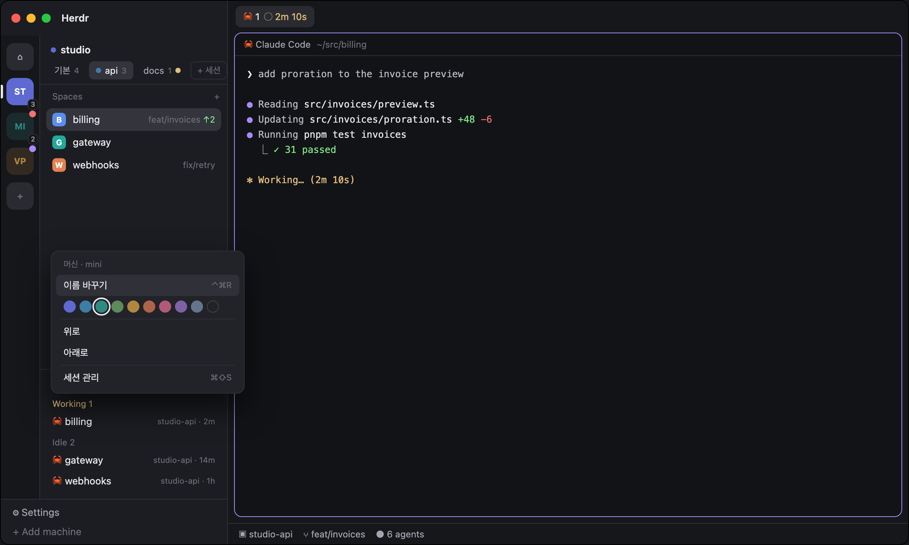

# Machine Rail for Herdr

**Many machines and many hc sessions, one at a time.** A Slack-style rail of computer tiles beside the sidebar; next to it the chosen computer's name and chips for its herdr-core (hc) sessions; below, only that session's spaces and agents. Name, color and order the tiles your way. A Sessions window lists every hc session on every machine and connects the ones the app doesn't show yet.



## Why

herdr-core runs separate sessions on one computer (`HC_SESSION`, `hc machine add <target> --session <name>`): each has its own terminals, spaces and tabs. The Herdr app shows each connected session as its own machine, so with a few computers and a few sessions each, the spaces list grows long and mixed. This layout groups those entries by the computer they reach and shows one at a time.

## Features

- **Rail.** One tile per computer (machine entries grouped by `host`), this one first. A small count when it has several sessions; a dot when an agent there is blocked, done or working while you look elsewhere.
- **Session chips.** The chosen computer's sessions with their space counts; `+` opens the Sessions window.
- **Filtered sidebar.** Spaces and Agents show only the chosen session. When a space elsewhere becomes active (`agent.next`, a notification, the picker), the rail follows it; when the space you were on closes, it stays. Switching returns to the space you last had there.
- **Space rows.** Each space shows its agents' state where the avatar was (working spins, blocked dot, done check, idle ring). Right-click for a color (a thin stripe; none by default). Spaces named after a Linear issue (`ENG-142 …`) get a chip with its state, when a Linear API key is found; without one, nothing is asked.
- **Yours.** Right-click a tile or chip: rename, one of nine muted colors, move up/down. Or drag to reorder. Names are display only (an `hc machine rename` would change terminal addresses).
- **Sessions window** (`⌘⇧S`). Per computer: every hc session, running or not, its live terminal count, its sidebar name and its spaces. Connect one (`hc machine add <target> --name <machine>-<session> --session <session>`), disconnect it (`hc machine rm`; its terminals keep running), or make a new one.

## Language

English or Korean, following your system (macOS language, else `$LANG`). To pick one, add `mods/machine-switch/config.json`:

```json
{ "language": "ko" }
```

## Install

1. Copy `layouts/machine-rail.json` and `layouts/machine-rail.png` into `~/.config/herdr-app/layouts/`, and every folder in `mods/` into `~/.config/herdr-app/mods/`.
2. Merge `keys.json` into `~/.config/herdr-app/keys.json`.
3. `herdr-app check ~/.config/herdr-app/mods/<each>`, then `herdr-app do layout.switch --name machine-rail` (or `⌘⇧L`).

Or ask the agent in your Herdr terminal: *"add herdr.dev/layouts/jenthous/herdr-machine-rail"*.

## Keys

| Key | Does |
|---|---|
| `⌃⌘↑` / `⌃⌘↓` | previous / next computer |
| `⌃⌘←` / `⌃⌘→` | previous / next session |
| `⌃⌘1` … `⌃⌘9` | the nth computer |
| `⌃⌘R` | rename the current computer |
| `⌘⇧S` | Sessions window |

## What it touches

- **Programs:** `hc machine ls` (every 15 s), `hc machine add` / `hc machine rm` when you connect or disconnect a session in the Sessions window, and one `sh` script per machine (over `exec`, while that window is open) that lists `~/.local/state/herdr-core/*` and checks each session's socket with `lsof`. It never runs an hc command against a session by name: hc starts a core for any session it is asked about.
- **Spaces list** (`session-spaces`, as Herdr's own): `git status` / `git rev-parse` in each space's folder on its machine when it could have changed, and every 60 s while the window is in front. When a space is named after an issue: `sh -lc` once to read `LINEAR_API_KEY`, else the credential files of herdr-linear and the Linear mod (`~/.config/herdr/plugins/config/jh.linear/credentials`, `~/.config/herdr-linear/credentials`).
- **Files:** those credential files, read only. Otherwise only the app's shared state: `machine.view`, `machine.prefs`, `space.colors` (`#7c818b` means no color), `linear.states`.
- **Network:** with a Linear key, `api.linear.app` (one request for all spaces' issues, every 90 s or when they change). None otherwise.

`mods/session-agents` is a `mod.clone` of Herdr's `agents` (0.1.x) with a filter added. `mods/session-spaces` and `mods/space-menu` are copies of [herdr-app-session-spaces](https://github.com/jenthous/herdr-app-session-spaces) (clones of Herdr's `spaces` and `menu`), kept here so this layout needs nothing else; `scripts/sync.sh` refreshes them. The cloned code stays under Herdr's terms.
