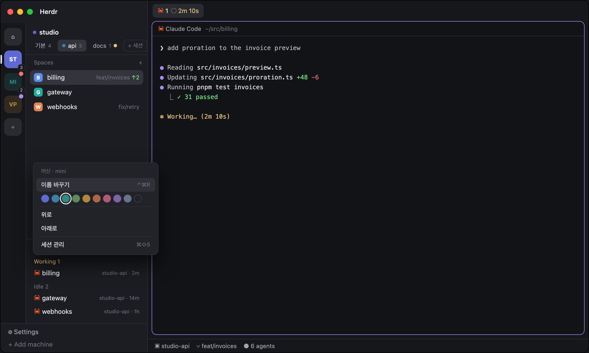

# Machine Rail

Herdr's main layout with a Slack-style rail of computers inside the sidebar: pick a computer on the rail, one of its herdr-core sessions from the chips beside it, and the spaces and agents lists below show only that session. Tiles and chips take your names, colors and order. A Sessions window lists every hc session on every machine and connects or disconnects them.

## What you see

- **Layout:** Herdr's `main` (titlebar none, traffic lights at 12,16; sidebar 268 px in `chrome`; tabs, panes as cards, Files/Changes panel, status bar), with the sidebar's `sidebar-lists` replaced by a row: a 52 px rail block, then a column of a 66 px header block over the lists.
- **Rail (52 px, `canvas` background, 1 px `border` on the right):** tiles 36 px square, radius 10, 10 px apart from 10 px down, centered.
  - This computer first, a `monitor` icon (until renamed), then one tile per computer in the saved order, then a `+` tile that opens `machine-add`.
  - A tile shows the name's initials, 11.5 px bold: two words → their first letters; one word → its first two; a trailing `mac`/`-mac` dropped; upper-cased.
  - No color: `surface` with `muted` text; chosen: `accent` with `accent_foreground`.
  - With a color: 18% tint (`#rrggbb2e`) with the color as text; chosen: solid with white text.
  - Chosen tile: a 3×18 px `foreground` bar at the rail's left edge, 9 px down.
  - Several sessions: a count badge at the bottom right (−6, −6), 9 px `muted` on `canvas` with a `border`.
  - Not chosen and an agent there needs attention: a 9 px dot at the top right (−3, −3): `blocked`, else `done`, else `working`.
  - Every session of it unreachable: 45% opacity.
- **Header (66 px, `chrome`, 1 px `border` below):**
  - Title row 28 px (10 px top, 14 px sides): a 7 px color dot when colored, then the computer's name, 13 px semibold.
  - Chips row 36 px (10 px sides, 4 px gap): one chip per session, 24 px high, 9 px padding, radius 6, 12 px: a 7 px color dot when colored, the session's name (`default` for the default session), its space count 10.5 px `dim` (or its state, `needs login`), and a 6 px status dot when not chosen. Chosen: `selected` background, `foreground` text; others `muted`, `hover` on hover.
  - Last, a bordered 24 px chip `+` (`Manage sessions` for this computer) that opens the Sessions window.
- **Spaces / Agents:** Herdr's own lists, filtered to the chosen session. An empty session shows one `+ New space` row; an unreachable one shows its state. A space row has no avatar: in its place the space's state (working spins, blocked/error a red dot, done a check, idle an empty ring); a Linear issue chip when the space is named after one and a key is found; a thin color stripe on the left edge only when the space was given a color (right-click). The details are in `session-spaces`' own recipe (herdr-app-session-spaces).
- **Menu (popup 256×300 at the pointer, `popover`):** a `dim` 11 px title "Machine · name" or "Session · name"; "Rename" (`⌃⌘R` hint on computers), which becomes an input (hint "Name (empty: the original)") and a Save button; a row of nine 16 px round swatches and a `×` for none (the chosen one ringed in `foreground`); a divider; "Move up"/"Move down" (chips: "Move left"/"Move right"); a divider; "Manage sessions" with `⌘⇧S`.
  - Colors: indigo `#5e6ad2`, ocean `#3d7ea6`, teal `#2f8a80`, moss `#5f8a5b`, amber `#b0873e`, rust `#b0634b`, rose `#b05a78`, plum `#7d62a8`, slate `#64748b`.
- **Sessions window (`window` overlay, key `sessions`, kept, 920 px × 80%):**
  - A 48 px header: "Sessions", a search field (hint "Find a space or session", `/` key cap), ↻ and ×.
  - Left, 232 px on `chrome`: "Computers", then one row per computer ("This computer" first): a 26 px `monitor`/`server` tile with a reach dot (green `ansi2` / `dim`), the name, its target or host (and "n sessions" when more than one), and on the right the status dots of its spaces (blocked, working, done) and its space count. The chosen one on `selected`.
  - Right, the chosen computer: its name 16 px, target and host in mono, `+ New session`.
    - "Shown in the app · n": a card per connected session: a running dot (green / `dim`), the name (a small `default` tag on the default one), a terminal icon and count or "stopped", the sidebar entry's name in mono after a `layers` icon. Its spaces below as chips that select the space (the active one ringed in `accent`, agent status dots inside); past 12 a dashed `+N more` chip, and a dashed `+ space` chip last. `Disconnect` shows only on hover and asks for a second click (the card turns `blocked`, with Cancel).
    - "On this computer, not in the app · n": one 38 px row per other session with `+ Show in app` (this computer: "Here the app opens only the default session").
  - Typing in the search replaces the right side with matches across every computer, grouped by computer: sessions by name (choosing one shows its computer) and spaces the app shows (choosing one selects it). The match is drawn in `accent`; ↑↓ and Enter pick.
  - A 30 px footer of key caps: ↑↓ computers, / find, n new session, r refresh, esc close; on the right, that disconnecting leaves terminals running.

## How it behaves

- **Language:** every text in English and Korean (`i18n.js`, the same file in `machine-switch` and `sessions`): `language` in `mods/machine-switch/config.json`, else macOS `defaults read -g AppleLanguages`, else `$LC_ALL`/`$LC_MESSAGES`/`$LANG`, else English. Input hints are drawn beside the input (a placeholder can't change after the language is known).

- **Grouping:** `hc machine ls --json` (every 15 s, `temporary` ones skipped) grouped by `host` (else target, else name). Within a computer, the entry without `session` first, then by session name. The computer's name is that entry's name, else the target.
- **The view:** shared `"machine.view"` = the chosen machine entry's name (null for this computer). `session-spaces` and `session-agents` show only spaces whose `machine` equals it and agents whose address prefix (`name/t7`) equals it (no prefix = this computer).
- **Choosing:** a tile picks the session last chosen there (`machine.last.<host>`), else the first. A chip picks that session. Either then selects the space last active on that entry (`machine.space.<entry>`), else its first.
- **Following:** on every render, when the active space changed and lives on another entry, the view moves there. The active space is remembered per entry. Except when the space you were on closed (exit in its last terminal): Herdr picks the next space, maybe on another entry, so the view stays and selects that entry's last space, else its first; with none left it shows the entry's empty list.
- **Statuses:** a computer's or session's status is the most urgent of its spaces': blocked > done > working.
- **Prefs:** shared `"machine.prefs"` = `{ order: [hostKey], sessionOrder: {hostKey: [entry]}, alias: {"g:host" | "s:entry": name}, color: {…: colorName} }`. This computer is `@local`. Ones not in an order keep their place after the ordered ones.
- **Drag:** press a tile (or chip) and release on another to move it there (before it when coming from below, after it when coming from above). The dragged one dims to 45% and the target gets a 2 px `accent` ring. Press and release on the same one is a click.
- **Keys:** `machine-switch.next|prev|session-next|session-prev|go:N|rename`, handled by the rail copy only (the header copy runs too and would double them).
- **Sessions window:**
  - Reads each computer once on open and every 20 s with one `sh -c` over `exec {on}`: for each `${XDG_STATE_HOME:-~/.local/state}/herdr-core/*/`, it prints the name, whether some process holds the socket named in `core.lock` (`lsof -t`), and the count of `"state":"live"` in `terminals.json`.
  - Connect runs `hc machine add [--via] <target> --name <base>-<slug(session)> --session <session> --json`, which also creates a new session; disconnect runs `hc machine rm <name>`.
  - This computer only lists its sessions: the app shows its default session.

- **Machine Stats (`window` overlay, key `machine-stats`, 760×420, `⌘⇧M`):** nothing runs while closed; on open and every 5 s, one `sh -c` (`probe.js`, POSIX, Darwin or Linux) per computer over `exec {on}`, one at a time per computer. Computers as the rail groups them, with its names, colors and order.
  - A 46 px header: "Machines" 14 px semibold, "Read while this window is open · every 5s" `dim`, then the update pill when one waits, `EN`/`한` (the other language), ↻ and ×.
  - Columns: the name (130 px, a 7 px color dot) then five equal heat cells, 40 px high, radius 6: CPU (the busiest process below), memory (used / total), swap (used), disk (free), load / core (load / cores). The percentage 13.5 px semibold, the detail 10.5 px at 75%. Background `accent`, from 75% `working` (text `background`), from 90% `blocked`, alpha 6% + 85% × use.
  - Click a row: OS, cores, uptime, sizes, load 1/5/15 and five processes (CPU %, RSS, name). Unreachable: the error in `blocked`; an old reading keeps showing with "n s old".
  - A 32 px footer, "Busiest": the busiest process anywhere at 50% or more, and memory or disk at 85% or more.
  - Language: shared `"machine-stats.lang"` (the `EN`/`한` button or `l`), else `machine-switch/config.json`, else the system's. `r` reloads, Esc closes.
- **herdr-core updates (`machine-switch/core.js`):** the header copy reads `releases.herdr.dev/core/latest.json` on start and every 15 min, at most every 6 h (shared `"machine-rail.core"`: `checked`, `latest`). Each refresh also reads this computer's `hc server status --json` version; remote versions come from `hc machine ls --json`. A computer with any entry older than `latest`:
  - Tile: a 15 px `accent` circle with a 9 px bold `↑` (`accent_foreground`) at its bottom left (−6, −6), ringed in `canvas`; tooltip "herdr-core 0.1.18 → 0.1.19 available".
  - Header title row, before the release pill: an 18 px pill, 6 px dot and "hc 0.1.18 → 0.1.19" in `accent`, tooltip that terminals keep running. First click: "Again to update hc"; second: "Updating hc…", then `hc update` when this computer is behind, then `hc machine update <entry>` for each outdated entry, then a refresh. On failure "hc update failed" in `blocked`, the error as tooltip.
- **Update check:** `mods/machine-switch/update.js` (the same file in `machine-stats`, and in herdr-app-linear, after Git Graph's). Machine Stats asks too when opened and shows the same pill, 22 px high, from the same shared state. The header copy (`style: "chips"`) asks on start and every 15 min; the pill sits at the right of the title row, 18 px high. At most once a day, one GET to `api.github.com/repos/jenthous/herdr-machine-rail/releases/latest` (no token, nothing about the person), remembered in shared `"machine-rail.update"` (`checked`, `latest`, `dismissed`, `off`). A release tag newer than `VERSION` (`0.3.0`) shows a pill in the header: a 6 px `accent` dot and "Update Machine Rail" (`Machine Rail 업데이트`), 11.5 px `accent`. Clicking it opens a 460×400 dialog (this mod again, props `{ role: "update", lang }`): "Machine Rail vX is out", the installed version, the prompt to give the agent in mono, the release notes as markdown, then "Stop checking" (never ask again), Later (hide this tag), Release page, Copy prompt.
## Built from

- **Layout:** `layouts/machine-rail.json`, Herdr's `main` with `sidebar-lists` replaced by `sidebar-body` (row, not resizable):
  - `machine-rail` (block 52 px, `machine-switch` `{style: "rail"}`)
  - `sidebar-main` (column):
    - `machine-switch` (block 66 px, `machine-switch` `{style: "chips"}`)
    - `sidebar-lists` with `session-spaces` and `session-agents`
- **Mods:**
  - `machine-switch`: rail, header and its own right-click menu as `props.menu`.
  - `session-agents`: `mod.clone` of Herdr's `agents`. Added: the `machine.view` filter, `+` making the space on the viewed machine.
  - `session-spaces`, `space-menu`: copies from herdr-app-session-spaces (their home; `scripts/sync.sh` copies them, `scripts/synced-from` names the commit). `session-spaces` filters to `machine.view` when a block of the layout shows `machine-switch`; `space-menu` adds the space color row to Herdr's `menu`.
  - `machine-stats`: the Machine Stats window (`main.js`), its probe (`probe.js`) and `update.js`.
  - `sessions`: the window (`main.js`) and its probe (`probe.js`). Shipped mods used: `workspace-chrome` (icons), `machine-add`.
- **herdr:** `hc`, `exec {on}`, `spaces`, `run` (`space.select`, `space.new {machine}`, `mod.open`), `shared`/`setShared`, `openOverlay`/`closeOverlay`, `nextCommand`, `theme`, `props`.
- **gpui:** `InputState`/`Input`, `h_flex`/`v_flex`, `svg(...).spin()`.

## Watch out

- Any hc command naming a session (`HC_SESSION=x hc …`, even `server status`) starts a core for it. Read state folders instead; connect only on a click.
- Save `mod.json` (`{"place":"none"}`) before `main.js`: a folder Herdr sees without it is docked into the shown layout on its own.
- Both `machine-switch` copies receive key commands; only one may act.
- `"transparent"` isn't a color: leave the background unset instead.
- `hc machine rename` changes `name/t7` addresses and the keys of `space.colors`; names here are display only.
- Nine swatches need the 256 px menu.
- A popup opened from a key has no pointer to sit at: open it at a fixed spot.
- `InputState` placeholders are fixed at creation, before the language is read: draw the hint yourself.

## Done when

- `herdr-app check` passes for every mod in `mods/` and `layout.switch {name: "machine-rail"}` shows the rail.
- With two sessions of one computer connected (`hc machine add <t> --session a`), the rail shows one tile with a `2` badge and the header shows two chips; choosing a chip lists only that session's spaces and agents.
- `machine-switch.go:2` chooses the second tile; `agent.next` to an agent on another computer moves the rail there.
- Right-click → a color tints the tile and fills it when chosen; rename changes the initials; dragging a tile reorders the rail and survives a restart.
- With `{"language": "en"}` every text is English; without it a Korean macOS shows Korean.
- A computer on an older hc shows `↑` on its tile; clicking its header pill twice brings it to the newest and the badge goes away.
- `⌘⇧M` shows every reachable computer's CPU, memory, swap, disk and load; `l` switches English/Korean and stays after reopening.
- `⌘⇧S` lists each computer's hc sessions; `Show in app` adds a machine entry and its tile's count grows.
